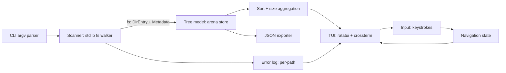
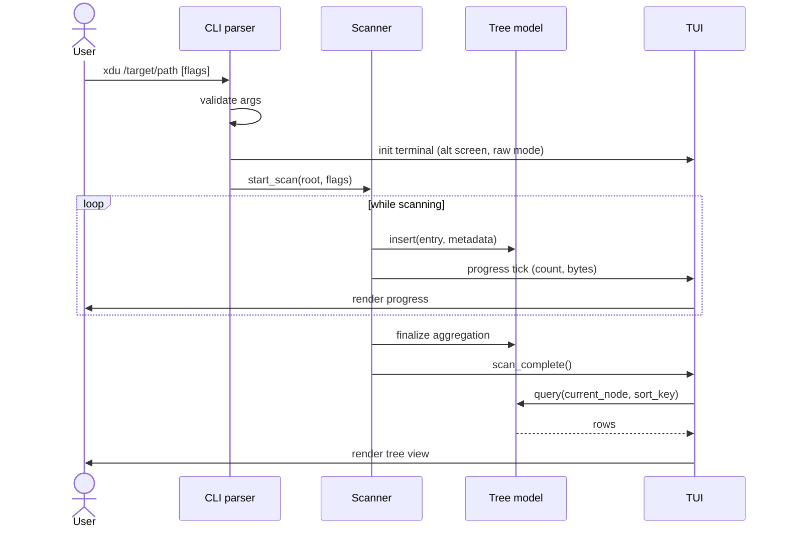
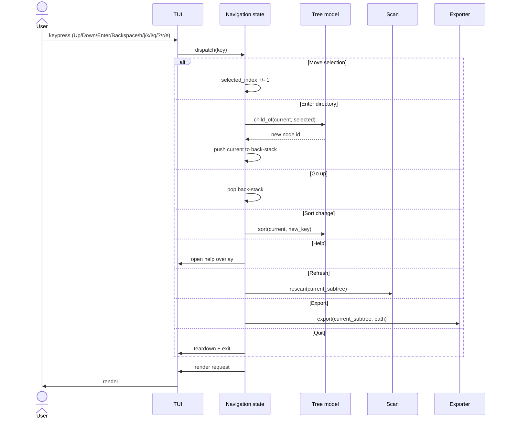
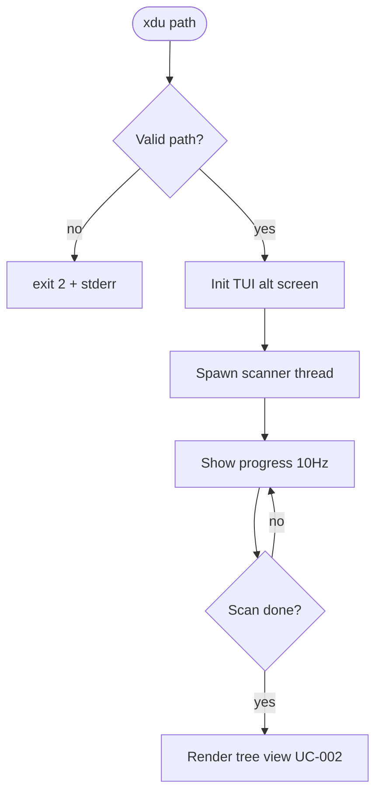
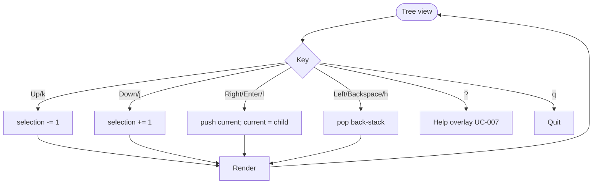
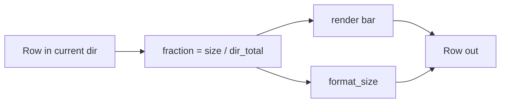
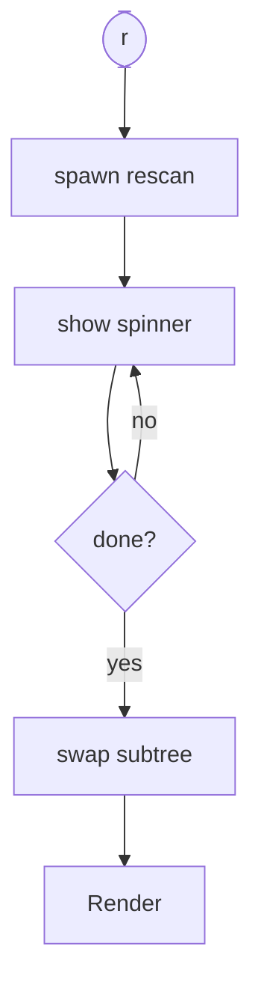
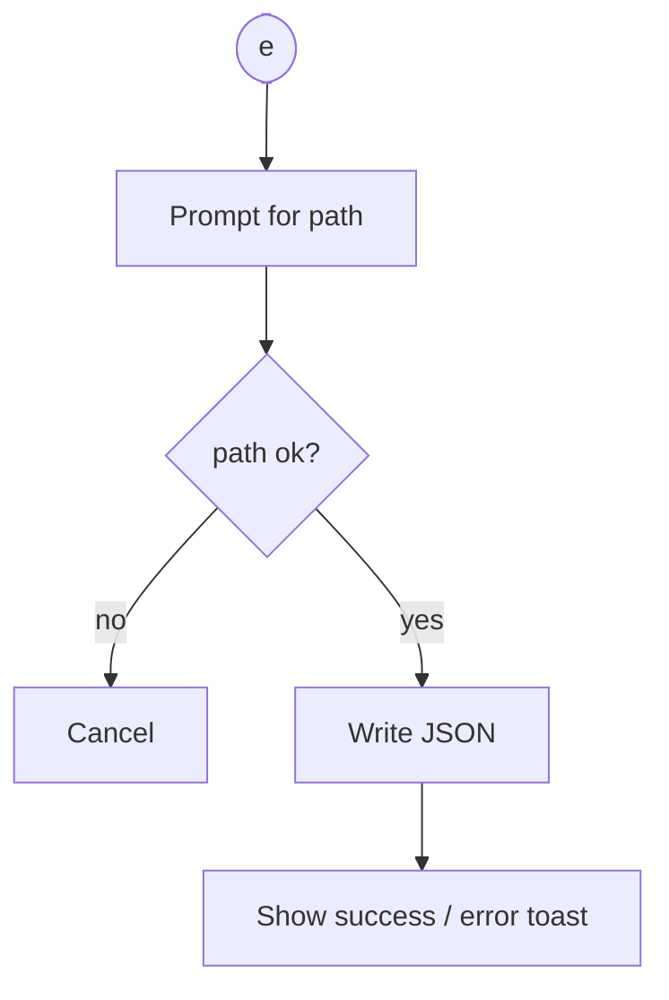
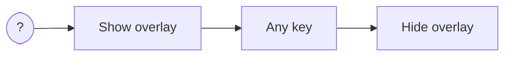

# xdu — Specification (v0.1.0 draft)

**Status:** DRAFT (awaiting user acceptance to advance to ACCEPTED)
**Last updated:** 2026-05-06

## 1. What the system does

`xdu` is a cross-platform command-line tool that scans a filesystem subtree and presents
the result as an interactive, read-only terminal UI. For each directory and file it shows:

- absolute on-disk size in human-readable units (B / KiB / MiB / GiB / TiB)
- a relative text bar showing the entry's share of its parent directory's total size

The user navigates the tree with the keyboard. No filesystem write operation is ever
performed (BR-001).

## 2. Business value

Users (developers, sysadmins, end-users) need to identify which directories or files are
consuming disk space without installing platform-specific tools and without risking
accidental deletion. `xdu` ships as a single static, dependency-free binary per platform,
making it deployable in containers, recovery shells, and locked-down corporate machines.

## 3. High-level architecture



See [`docs/architecture/ADR-001-baseline-architecture.md`](architecture/ADR-001-baseline-architecture.md)
for the chosen baseline and rejected alternatives.

## 4. Business rules

| ID      | Rule                                                                             |
|---------|----------------------------------------------------------------------------------|
| BR-001  | All file-system operations MUST be read-only. No `unlink`, `rename`, `chmod`, `truncate`, or any equivalent on any platform, ever, under any code path. |
| BR-002  | Hardlinks MUST be counted once per `(device, inode)` pair on Unix. The first traversal records the size; subsequent encounters add only a logical reference, never re-add allocated bytes. **v0.1.0 limitation:** on Windows hardlink deduplication is OFF (each NTFS hardlink contributes its size separately). See §9 Known limitations. |
| BR-003  | Scans MUST NOT cross filesystem mount/volume boundaries by default on Unix (`Metadata::dev()` check). An explicit `--cross-fs` flag opts in. **v0.1.0 limitation:** on Windows `--cross-fs` is a no-op (volume detection deferred). Because BR-004 forbids following symlinks/junction points, most Windows cross-volume traversal does not occur in practice. See §9 Known limitations. |
| BR-004  | Symbolic links MUST NOT be followed by default. They are recorded as their own size (link target string length on Unix; reparse-point size on Windows), never their target. An explicit `--follow-symlinks` flag may be added in a later version (OUT for v0.1.0). |
| BR-005  | Per-entry I/O errors (permission denied, I/O error, broken link) MUST NOT abort the scan. They MUST be recorded and surfaced in the UI as an error count and an inspectable error log. |
| BR-006  | Default size unit is **IEC binary** (1 KiB = 1024 B). A `--si` flag switches to decimal (1 KB = 1000 B). |

## 5. Workflows

### WF-001 — Scan and display



### WF-002 — Navigation



## 6. Use cases

### UC-001 — Scan a target directory

**Summary:** scan a user-specified directory and build the in-memory size tree.

**Description:** the user runs `xdu <path> [flags]`. The tool initializes the TUI,
spawns the scan, shows live progress, and transitions to the interactive view on
completion.

**Related BR/WF:** BR-002, BR-003, BR-004, BR-005, BR-006, WF-001.

#### Functional Requirements
- Acceptance: after running `xdu <path>`, the user lands in the interactive tree view rooted at `<path>` with size totals for every direct child.
- Inputs: positional `<path>` (default `.`), flags `--cross-fs`, `--si`, `--exclude <glob>` (repeatable), `--no-progress`, `--version`, `--help`.
- Outputs: terminal UI; on quit returns exit code `0` if scan completed, `2` if the path was invalid, `3` if a fatal I/O error occurred (per-entry errors do NOT cause non-zero exit per BR-005).
- Validation: path MUST exist and be a directory. Non-existent / non-directory paths fail fast with stderr message and exit `2`.
- Failure modes: invalid path → `2`; fatal init error (cannot enter raw mode) → `3` with restored terminal; per-entry I/O errors → counted, not fatal.

#### Technical Requirements — Backend
- API: internal `fn scan(root: &Path, opts: ScanOpts) -> ScanHandle` returning a non-blocking handle with `progress() -> ScanProgress` and `join() -> ScanResult`.
- Walker: stdlib `std::fs::read_dir` + `Metadata`; no external traversal crate.
- Hardlink dedup: maintain `HashSet<(u64, u64)>` (Unix dev+inode) or Windows equivalent.
- Mount detection: Unix compare `Metadata::dev()` against root's dev; Windows compare volume serial via `GetVolumeInformationByHandleW`.
- Errors: each per-entry error pushed to a bounded `Vec<ScanError>` (cap 10 000; overflow counter).
- Security: refuse paths containing null bytes; never spawn subprocesses; never read file *contents* — only metadata.

#### Technical Requirements — Frontend
- Screens: progress screen, tree view, help overlay, error log overlay.
- Interactions: `q` aborts scan; otherwise progress is read-only.
- Progress refresh rate: 10 Hz max (avoid flicker on slow terminals).

#### Flow (Mermaid)


#### Schematic layouts
- `docs/ui-schematics/UC-001/01-progress.txt` (to be authored in DESIGN sub-task)

#### Baseline screenshots
- `docs/ui-baselines/UC-001/01-progress.txt` (TUI text snapshots; created in TESTING sub-task)

---

### UC-002 — Navigate the scanned tree

**Summary:** move the selection through the directory tree using the keyboard.

**Description:** after a scan completes, the user navigates with arrow keys (Up/Down to
move within a directory, Right/Enter to descend, Left/Backspace to ascend). vi-style
`hjkl` MUST also work. Navigation is read-only.

When the user ascends from the scan root with an empty back-stack, `xdu` triggers a
synchronous scan of the filesystem parent directory and resets navigation to the
parent-rooted view. When the current root is already the filesystem root (e.g. `/`
on Unix), the action is a no-op with a status message. This behavior fixes BUG-001
and amends the prior "cannot go above scan root" wording.

**Related BR/WF:** WF-002.

#### Functional Requirements
- Acceptance: keystrokes move selection / descend / ascend with O(1) latency on trees up to 5 M entries.
- Inputs: `Up`/`k`, `Down`/`j`, `Right`/`Enter`/`l`, `Left`/`Backspace`/`h`, `Home`, `End`, `PgUp`, `PgDn`, `q` quit, `?` help.
- Outputs: re-rendered view with new selection / current directory.
- Validation: descending into a non-directory entry is a no-op (visually flashes selection).
- Failure modes: none beyond no-op.

#### Technical Requirements — Backend
- Navigation state: `current_node_id: NodeId`, `selection_index: usize`, `back_stack: Vec<(NodeId, usize)>`.

#### Technical Requirements — Frontend
- Active row highlighted via inverted style; visible-window scrolling keeps selection on screen.
- Path breadcrumb shown in header.

#### Flow (Mermaid)


#### Schematic layouts
- `docs/ui-schematics/UC-002/01-tree-view.txt`

#### Baseline screenshots
- `docs/ui-baselines/UC-002/01-root.txt`
- `docs/ui-baselines/UC-002/02-descended.txt`
- `docs/ui-baselines/UC-002/03-ascended.txt`

---

### UC-003 — View entry sizes with bar + absolute value

**Summary:** display each entry's allocated size as a number and as a relative bar.

**Description:** in the tree view, every row shows: relative-bar | absolute-size | entry-name [/ if dir].
The bar length is proportional to `entry.size / current_dir.total_size`. Bar uses Unicode block
elements (`█▉▊▋▌▍▎▏`) with ASCII fallback (`#` filled, ` ` empty) when the terminal does
not advertise UTF-8.

**Related BR/WF:** BR-006.

#### Functional Requirements
- Acceptance: bar widths sum to the visible scaled total; longest row in current dir has full-width bar; other rows scale proportionally.
- Outputs: row format `<bar:10>  <size:>9>  <name>`; bar always exactly 10 cells wide.
- Validation: 0-byte entries get an empty bar; entries equal to parent total get a full bar.
- Failure modes: missing UTF-8 → ASCII fallback; very small terminal (< 40 cols) → name truncated with `…`.

#### Technical Requirements — Backend
- Formatter: `fn format_size(bytes: u64, mode: SizeMode) -> String` produces e.g. `1.4 MiB`. Edge cases: `0 B`, `<1 KiB`, exactly `1024 B → 1.0 KiB`.
- Bar generator: `fn bar(fraction: f64, width: usize, utf8: bool) -> String`. Fraction clamped to `[0.0, 1.0]`.

#### Technical Requirements — Frontend
- Color: directory rows in cyan; large entries (>10% of dir) in yellow; >25% in red. Color disabled when `NO_COLOR` env var is set or terminal lacks color support.

#### Flow (Mermaid)


#### Schematic layouts
- `docs/ui-schematics/UC-003/01-row-format.txt`

#### Baseline screenshots
- `docs/ui-baselines/UC-003/01-mixed-sizes.txt`
- `docs/ui-baselines/UC-003/02-no-color.txt`
- `docs/ui-baselines/UC-003/03-ascii-fallback.txt`

---

### UC-004 — Sort and order entries

**Summary:** change the sort order of the entries in the current directory.

**Description:** user presses `s` to cycle sort key (size desc → name asc → count desc → size asc → name desc → count asc → size desc); the view re-renders. Default is **size descending**.

**Related BR/WF:** —

#### Functional Requirements
- Acceptance: pressing `s` cycles through six sort modes; the active mode is shown in the footer.
- Outputs: re-sorted rows.
- Failure modes: none.

#### Technical Requirements — Backend
- `enum SortKey { SizeDesc, SizeAsc, NameAsc, NameDesc, CountDesc, CountAsc }`. Cycle order fixed.
- Sort is stable; ties broken by name ascending.

#### Technical Requirements — Frontend
- Footer shows e.g. `sort: size↓` with arrow indicator.

#### Flow (Mermaid)


#### Schematic layouts
- `docs/ui-schematics/UC-004/01-footer.txt`

#### Baseline screenshots
- `docs/ui-baselines/UC-004/01-size-desc.txt`
- `docs/ui-baselines/UC-004/02-name-asc.txt`

---

### UC-005 — Refresh / rescan a subtree

**Summary:** rescan the currently focused directory.

**Description:** user presses `r`. The current subtree is dropped and re-scanned with the
same flags. Other parts of the tree are preserved (no full rescan).

**Related BR/WF:** WF-001 partial.

#### Functional Requirements
- Acceptance: after `r`, the focused subtree's totals reflect the current filesystem state; sibling subtrees are unchanged.
- Failure modes: rescan target deleted between scans → entry removed from parent; reported in error log.

#### Technical Requirements — Backend
- API: `fn rescan(node: NodeId, opts: ScanOpts) -> ScanHandle`.
- Replaces children of `node` atomically (build new subtree, swap pointer).

#### Technical Requirements — Frontend
- Header shows "rescanning…" with spinner during operation.

#### Flow (Mermaid)


#### Schematic layouts
- `docs/ui-schematics/UC-005/01-rescan.txt`

#### Baseline screenshots
- `docs/ui-baselines/UC-005/01-rescanning.txt`
- `docs/ui-baselines/UC-005/02-after-rescan.txt`

---

### UC-006 — Export current subtree to JSON

**Summary:** write a JSON dump of the currently focused subtree to a file.

**Description:** user presses `e`, prompted for a path (defaulting to `xdu-export.json` in CWD). The tool writes a deterministic JSON document representing the subtree.

**Related BR/WF:** BR-001 (export does not modify the scanned filesystem; it writes only the export file).

#### Functional Requirements
- Acceptance: file is created (or overwrites existing on user confirm) containing the subtree.
- Output schema (xdu-native, NOT ncdu-compatible):
  ```json
  {
    "schema": "xdu-export-1",
    "scanned_at": "2026-05-06T12:34:56Z",
    "root": "/path/to/root",
    "options": { "cross_fs": false, "si": false, "follow_symlinks": false },
    "tree": {
      "name": "root",
      "kind": "dir",
      "size_bytes": 12345,
      "alloc_bytes": 16384,
      "entries": 42,
      "children": [ ... ]
    }
  }
  ```
- Failure modes: write error → toast in UI, no overwrite.

#### Technical Requirements — Backend
- Writer: streaming JSON via hand-rolled encoder (no `serde_json` dep) to keep binary small. (Decision deferred to TASK-001-L; ADR-001 records this as a candidate optimization.)
- Path validation: refuse paths containing null bytes; refuse writing inside `/proc`, `/sys`, `/dev` on Linux.

#### Technical Requirements — Frontend
- Modal prompt with default path; Enter to confirm, Esc to cancel.

#### Flow (Mermaid)


#### Schematic layouts
- `docs/ui-schematics/UC-006/01-export-prompt.txt`

#### Baseline screenshots
- `docs/ui-baselines/UC-006/01-prompt.txt`
- `docs/ui-baselines/UC-006/02-success-toast.txt`

---

### UC-007 — Help overlay

**Summary:** show an in-app help screen listing all keybindings.

**Description:** user presses `?` (or `F1`). A modal overlay lists every keybinding and a short description. Any key dismisses it.

**Related BR/WF:** —

#### Functional Requirements
- Acceptance: pressing `?` shows the help overlay; pressing any key dismisses it.
- Content MUST list every keybinding accepted in any UC.

#### Technical Requirements — Backend
- Static text table.

#### Technical Requirements — Frontend
- Centered box ≤ 60 cols × 20 rows; bordered; dim background.

#### Flow (Mermaid)


#### Schematic layouts
- `docs/ui-schematics/UC-007/01-help.txt`

#### Baseline screenshots
- `docs/ui-baselines/UC-007/01-help.txt`

---

## 7. UI design tokens (preliminary)

For TUI rendering — not full §4.1.3 web-style tokens. Recorded in
`docs/ui-design-tokens.md` after `BUILD` begins.

| Role        | 16-color | 256-color | Truecolor (rgb)     | Notes                         |
|-------------|----------|-----------|---------------------|-------------------------------|
| Default     | default  | default   | default             | Terminal default              |
| Dir         | cyan     | 51        | rgb(102, 217, 239)  |                               |
| File        | default  | default   | default             |                               |
| Selection   | inverted | inverted  | inverted            | Style: reverse video          |
| Warn (>10%) | yellow   | 220       | rgb(241, 196, 15)   |                               |
| Hot (>25%)  | red      | 196       | rgb(231, 76, 60)    |                               |
| Bar fill    | default  | 240       | rgb(120, 120, 120)  |                               |
| Bar empty   | default  | 235       | rgb(40, 40, 40)     |                               |
| Error       | red      | 196       | rgb(231, 76, 60)    | for error overlay             |
| Help        | default  | default   | default             | bordered, bg dim if supported |

Color paths: truecolor → 256-color → 16-color → no-color. `NO_COLOR` env var honored.

## 9. Known limitations (v0.1.0)

These are tracked as v0.2 follow-up tasks and are documented in this section so users
do not encounter them as surprises.

| Limitation                                          | Impact                                                                                       | Follow-up      |
|-----------------------------------------------------|----------------------------------------------------------------------------------------------|----------------|
| Windows: no hardlink deduplication (BR-002)         | Each NTFS hardlink counts toward total size separately. Rare in user data; common in some build trees. | v0.2 / `LATER-001` |
| Windows: `--cross-fs` is a no-op (BR-003)           | The scan stays on whatever volume is reached via plain `read_dir`. Reparse points / mountvol mounts are not detected. BR-004 (no symlink follow) provides partial mitigation. | v0.2 / `LATER-002` |
| `--exclude <glob>` flag deferred (UC-001)           | v0.1.0 scans the full subtree; users cannot exclude `node_modules/` or similar before scan.  | v0.2 / `LATER-003` |
| TUI snapshot test harness deferred (M / §13.3.4)    | UI baselines stored as paths in this spec are NOT validated automatically in v0.1.0. Visual inspection at release. | v0.2 / `LATER-004` |
| macOS targets not built by default                  | Built only when `osxcross` SDK is present. Users on macOS build from source via host toolchain. | v0.2 / `LATER-005` |
| Coverage measurement not wired (M / §7.1)           | 100% line/branch/function coverage is enforced by writing tests for every function; not measured by `cargo-llvm-cov`. | v0.2 / `LATER-006` |

## 10. Inventory references

- `docs/architecture/ADR-001-baseline-architecture.md` — chosen architecture and rationale.
- `docs/backlog/TASK-001-ncdu-clone-rust.md` — parent backlog item.
- `docs/installation-manual.md`, `docs/development-manual.md`, `docs/configuration-manual.md` — to be authored at TASK-001-N.
